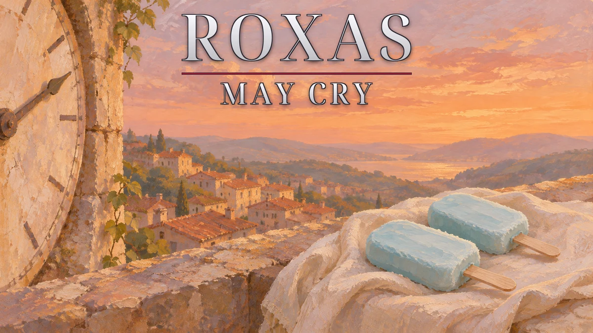
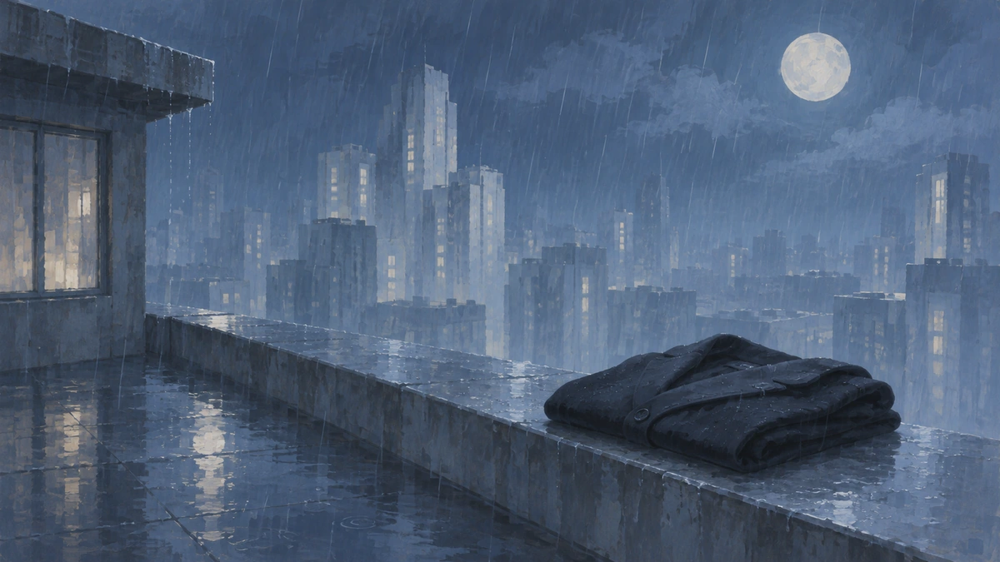
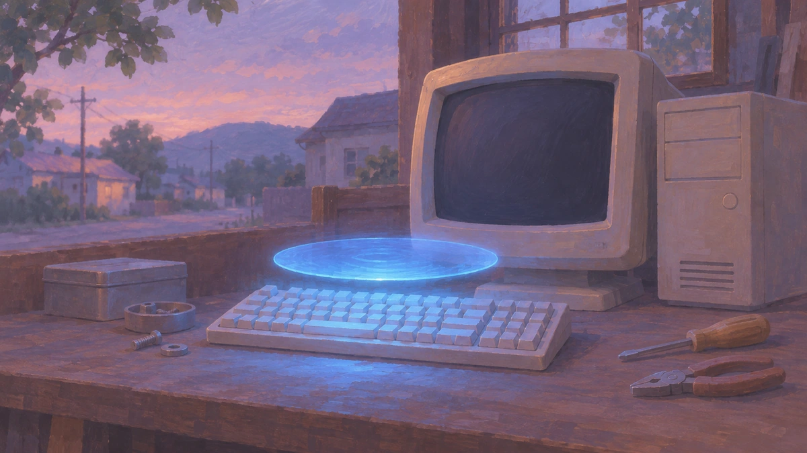
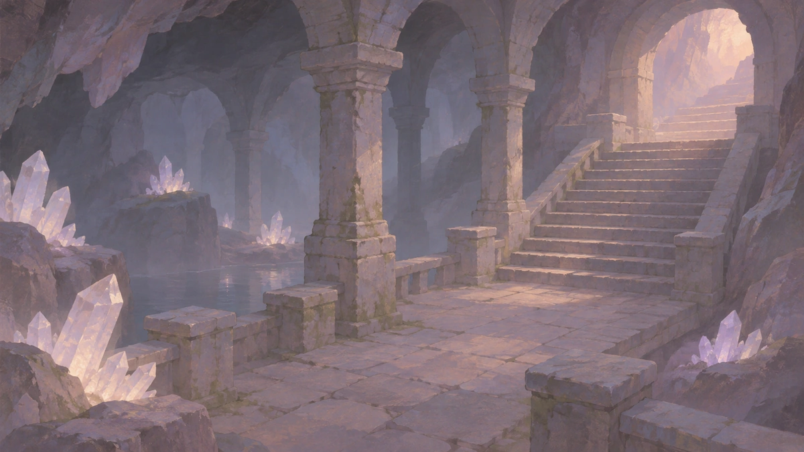

# Roxas May Cry 1.2.4



Play Nobody May Cry’s Roxas campaign through The World That Never Was, the ending and postgame in the Steam edition of Kingdom Hearts II Final Mix. This repository is a builder: it makes the mod on your PC from your own copy of the game. It holds patches and code, no game files.

## what's in it

<table>
<tr>
<td width="50%" valign="top"><br><b>the late game</b><br>the Land of Dragons Summit duel, the Organization encounters and the castle ascent, finished and fixed.</td>
<td width="50%" valign="top"><br><b>Holo-Missions</b><br>the computer in Merlin’s House runs all three missions again, with first clears, replays and rewards.</td>
</tr>
<tr>
<td width="50%" valign="top"><br><b>four modes</b><br>Critical, Less Than Nothing, Xion Knows Best and Xion Always Cries.</td>
<td width="50%" valign="top"><br><b>settings menu and cheats</b><br>infinite HP, MP and Drive, EXP and drop multipliers, names and title logos, changed in game.</td>
</tr>
<tr>
<td width="50%" valign="top"><br><b>Character switching</b><br>swap between Roxas and Xion whenever you want, in every mode.</td>
<td width="50%" valign="top"><br><b>the ending and PS2 rules</b><br>the final battles with their PS2 resistance and one-HP rules, pause-to-skip and the results screen.</td>
</tr>
<tr>
<td width="50%" valign="top"><br><b>postgame</b><br>the Cavern of Remembrance, the Absent Silhouettes, the data fights and Mushroom XIII.</td>
<td width="50%" valign="top"></td>
</tr>
</table>

- Finish the Summit duel, the Organization encounters and the castle ascent. The Betwixt and Between reward includes Awakened alongside Bond of Flame.
- New in 1.2.4: the Marluxia and Larxene story arenas are built as their own rooms from your game, their intro scenes show the right weapons, the Space Paranoids room of the Day 96 mission loads, and the menu text explains Item Slots and Less Than Nothing’s recovery drain.
- The Holo-Missions work from start to finish. The computer in Merlin’s House launches the Day 25, Day 96 and Day 193 missions, later terminal pages open, the Day 96 boss room loads, its chests give their own items, an aborted replay returns to the terminal and the Sandlot fight continues after the shield drops.
- The final battles restore PS2 resistance and one-HP rules. The ending supports pause-to-skip and the results screen.
- Postgame fixes cover the Cavern of Remembrance Necromancer, Absent Silhouette books, the Zexion fight, Data Marluxia’s Doom count and three Mushroom XIII encounters.
- Change cheats, EXP and drop multipliers, tutorial HP, names and title logos in the settings menu. Open it with RB/R1 or F2 at New Game / Load, or hold L3 or Shift while opening camp.
- Menu, pause screen, HUD and save point fixes for both characters.
- The HD Xion pack adds character switching, Xion Knows Best and Xion Always Cries. The standard build offers Beginner, Standard, Critical and Less Than Nothing.

## build and install

1. Have the Steam KH 1.5+2.5 collection, Python 3.10 or newer, OpenKH Mods Manager with Panacea, and a local copy of the original PC NMC mod at revision `79a23a6`. Preserve its file contents and line endings. The full decomposition reads donor assets from that copy. Get a local copy of [nmc-decomposed](https://github.com/dexedrne/nmc-decomposed).
2. Open a terminal in this repository. Substitute your three directory names below. On Linux, use `python3` in place of `py -3`.

   ```sh
   py -3 tools/build-rmc.py "STEAM_COLLECTION" --decomposition "NMC_DECOMPOSED" --nmc "ORIGINAL_NMC"
   ```

   If you already rebuilt NMC with the decomposition’s default preset, use `--rebuilt "NMC_BUILD/installed"` in place of the two NMC arguments. An existing six-package decomposition extraction can be passed with `--clean`.

3. For the PS2 Xemnas I costume, motions and Betwixt reward icon, add `--ps2 "KH2FM.NEW.ISO"` using your own PS2 NMC image. The default uses PC form assets and a KH2 item icon.
4. Import the resulting `roxasmaycry.zip` as a local ZIP in OpenKH Mods Manager. Select KH2 PC, disable other copies of NMC, enable Roxas May Cry, then build and launch with Panacea enabled. Keep the generated ZIP private.

## optional HD Xion

Use UE Viewer (umodel, glTF export) on your own KH3 installation. Export `Game/Character/npc/n_ex033/mdl/n_ex033_0` with its binary buffer and textures. Keep the export tree, including the shared eye, mouth, hair mask and coat textures. The tested export used UE Viewer build 1590. This conversion uses Blender 5.2.3 on PATH, NumPy 2.5.4 and Pillow 13.0.0. The standard builder uses only Python’s standard library.

```sh
py -3 tools/build-xion.py "EXPORT/Game/Character/npc/n_ex033/mdl/n_ex033_0.gltf" --textures "EXPORT" --game "STEAM_COLLECTION" --nmc "ORIGINAL_NMC" --out "my-looks"
py -3 tools/build-rmc.py "STEAM_COLLECTION" --decomposition "NMC_DECOMPOSED" --nmc "ORIGINAL_NMC" --looks "my-looks" --output "roxasmaycry-hd.zip"
```

Use a fresh output path for each build. Both Xion looks use the player’s KH2/NMC HUD, shop faces and voice banks. The KH3 export supplies the face on the character model.

## license

our code is MIT ([LICENSE](LICENSE)). the two script fonts keep their SIL Open Font Licenses ([fonts/](fonts)). the OpenKH package reader keeps its own license ([tools/LICENSE-OpenKH](tools/LICENSE-OpenKH)).

## more kingdom hearts stuff

- [NMC Fixed](https://github.com/dexedrne/NMC-Fixed): the original mod with every fix and addition, for the Steam version through OpenKH
- [Nobody May Cry: Recompiled](https://github.com/dexedrne/nmc-recomp): the game and the mod recompiled to run natively on iPhone, macOS and Linux
- [nmc-decomposed](https://github.com/dexedrne/nmc-decomposed): the mod as readable patches, rebuilt from your own copy of the game
- [kh2fm-save-converter](https://github.com/dexedrne/kh2fm-save-converter): bring a PS2 (PCSX2) Final Mix save into the Steam version
- [358/2 Days on iPhone](https://github.com/dexedrne/khdays-port/tree/ios) (work in progress): the native Days port brought to iPhone and iPad, dual screens, touch and controllers
